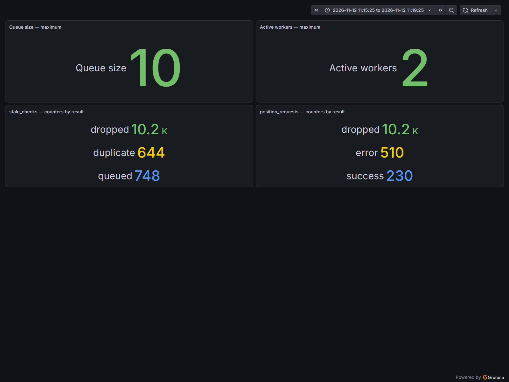

# Реальные метрики ЛР3 под нагрузкой

Крупные фрагменты того же обзорного снимка (тот же момент и те же данные, без изменения значений): [queue size](02-queue-size.png), [active workers](03-active-workers.png), [stale_checks](04-stale-checks.png), [position_requests](05-position-requests.png). Временной диапазон виден на полном снимке.

Это снимки настоящего Grafana dashboard `lab3-pr-final`, читающего Prometheus окружения ЛР3 через OTLP Collector. Графики/значения не генерировались из ожидаемых результатов тестов. Для устойчивого снимка использованы стандартные **Stat**-панели: максимум реально собранных значений за фиксированный интервал. Картинки не показывают мгновенное состояние после остановки нагрузки.

Окно данных: **12.11.2026 11:15:25–11:19:25, Asia/Yekaterinburg (UTC+5)**. Полный исходный ряд с timestamps: [prometheus-data.json](prometheus-data.json). Параметры запуска и фазы: [capture.json](capture.json). Импортируемая конфигурация Grafana: [dashboard.json](dashboard.json), datasource UID `prometheus`.

Нагрузка ограничена четырьмя минутами: 200 синтетических stale-поездок в отдельной временной БД; `POSITION_QUEUE_SIZE=10`, `POSITION_WORKERS=2`, check=2s, batch=100, Push timeout=2s, OTLP export=2s. Было три фазы: 0–60s latency=5000ms; 60–120s latency=500ms; 120–240s latency=500ms/fail_rate=1. Это один запуск для метрик, не повтор полного smoke-набора.

| Панель | PromQL | Максимум в сохранённой выборке |
| --- | --- | --- |
| Queue size | `sum(tripgo_position_requests_queue_size{exported_job=~".*trip-service-lab3-pr"})` | **10**, предел не превышен |
| Active workers | `sum(tripgo_position_requests_workers_active{exported_job=~".*trip-service-lab3-pr"})` | **2**, предел не превышен |
| stale_checks по result | `sum by(result)(tripgo_stale_checks_total{exported_job=~".*trip-service-lab3-pr"})` | queued=748, duplicate=644, dropped=10208 |
| position_requests по result | `sum by(result)(tripgo_position_requests_total{exported_job=~".*trip-service-lab3-pr"})` | success=230, error=510, dropped=10210 |

Счётчики показаны как максимум sampled counter в окне, не как rate и не как точное количество всех событий до остановки. Grafana сокращает 10208/10210 до `10.2 K`; JSON сохраняет точные значения. Разница dropped в два события соответствует семантике вытеснения: eviction увеличивает `position_requests{dropped}`, а новая принятая задача учитывается как `stale_checks{queued}`.

Фильтр использует **exported_job**: `job` у этого collector равен `otel-collector`; исходные атрибуты приложения экспортируются как `exported_job` и `exported_instance`. Сервис этого запуска — `trip-service-lab3-pr`; данные других лабораторных не смешиваются.

После нагрузки Push сброшен в `latency_ms=0`, `fail_rate=0`, `rate_limit_rps=0`; процесс остановлен и только собственная временная БД удалена. Dashboard оставлен доступным для просмотра истории; ни `.env`, ни настройки других окружений не менялись.

Интерактивный Computer Use в этой сессии был недоступен. Снимки сделаны отдельным headless Chromium-рендерером реальных страниц Grafana, без управления пользовательским браузером и без дорисовывания метрик. У Grafana наблюдались автоматические рестарты; настройка ресурсов и принудительные рестарты не выполнялись. Новые снимки Jaeger/duration/rows в этот каталог не добавлялись: текущая подготовка ограничена четырьмя запрошенными метриками.
